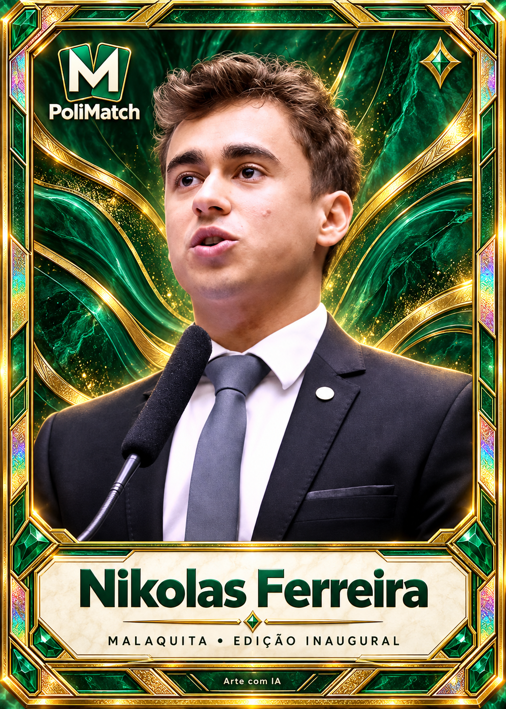
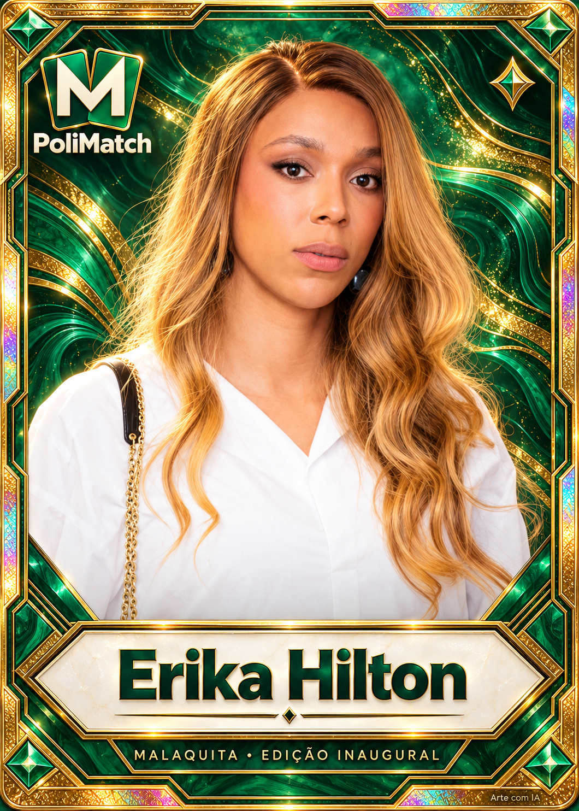
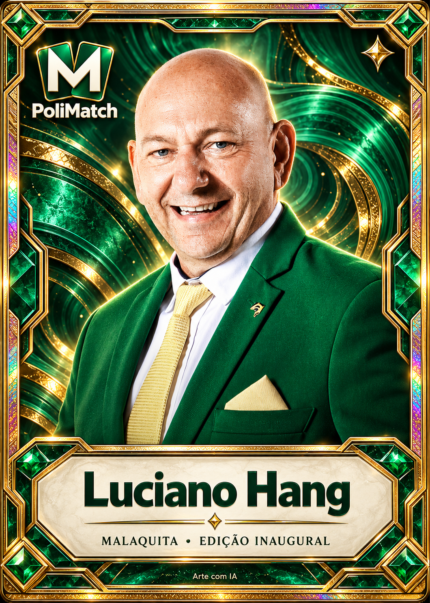
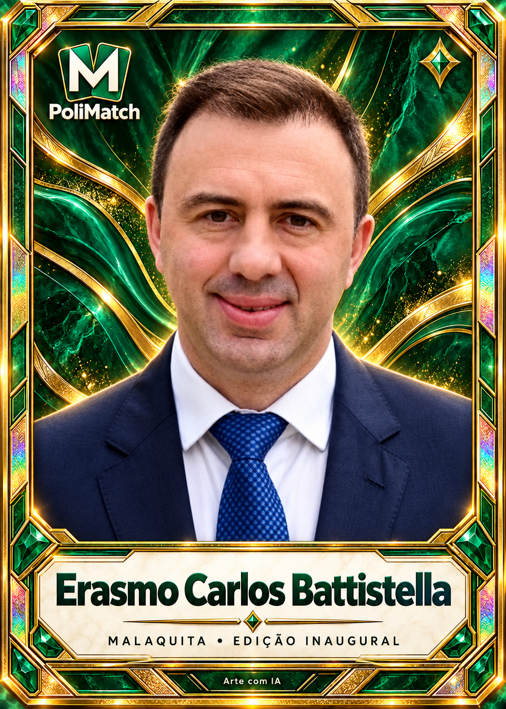
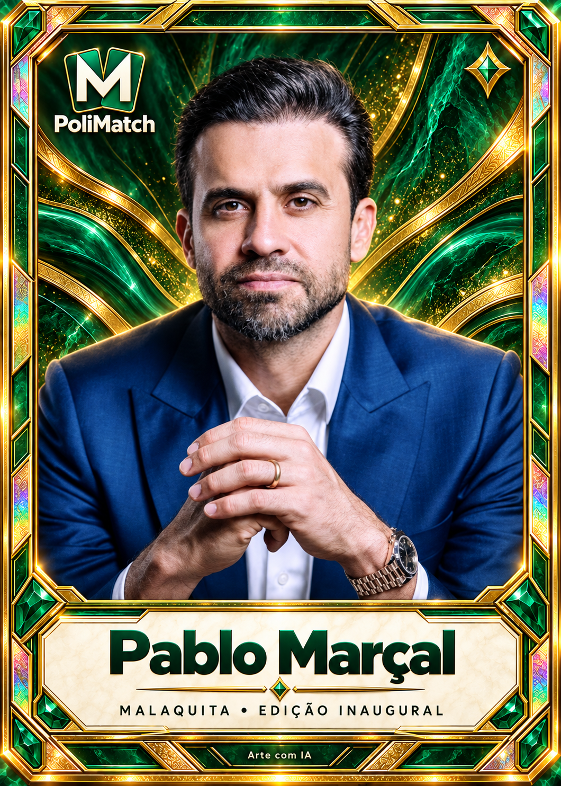
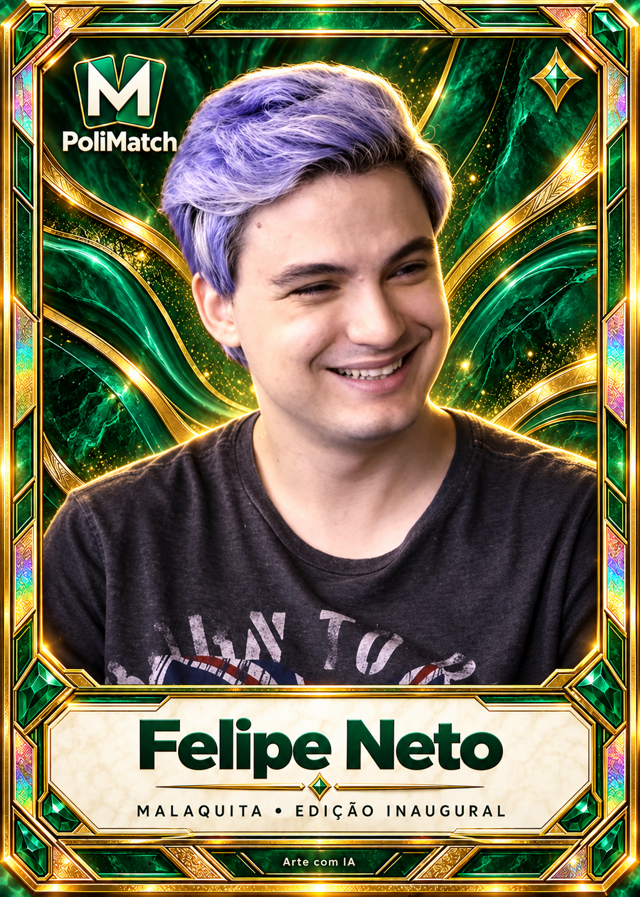
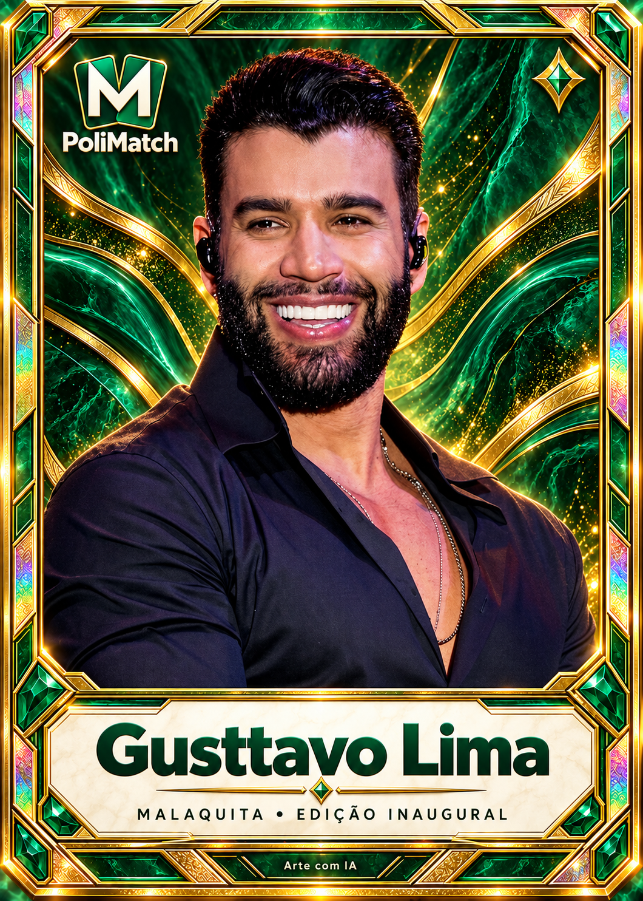
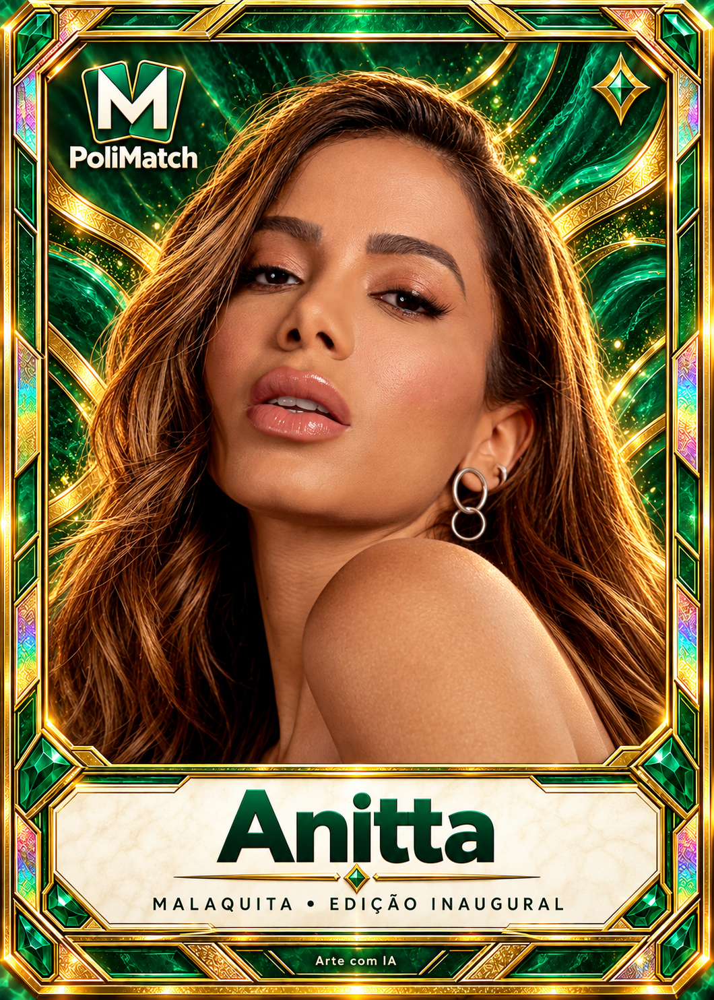
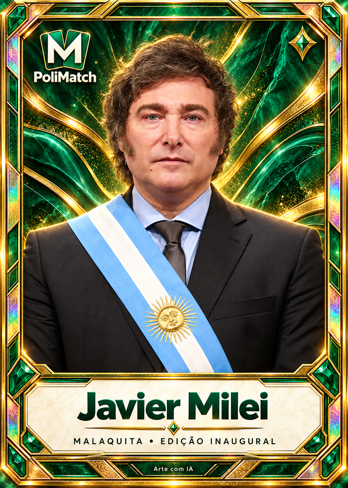
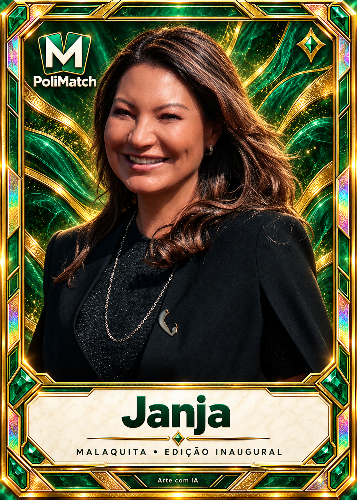

# PoliMatch — Chromas 104 · primeiro lote

Pilotos para revisão; não publicados. Nome, semelhança e acabamento precisam de
aprovação humana. Os retratos foram editados com inteligência artificial.

| Nikolas Ferreira | Erika Hilton |
|---|---|
|  |  |

| Luciano Hang | Erasmo Carlos Battistella |
|---|---|
|  |  |

| Pablo Marçal | Felipe Neto |
|---|---|
|  |  |

| Gusttavo Lima | Anitta |
|---|---|
|  |  |

| Javier Milei | Janja |
|---|---|
|  |  |

## Aprovação posterior — 22/10/2026
Stefan aprovou este lote de dez e autorizou integração: “Show. Implementa no site”.
O estado pendente acima descreve a entrega anterior. As outras 94 pessoas e
as versões adicionais continuam sem arte/aprovação. Integração: estágio 24, #253.
